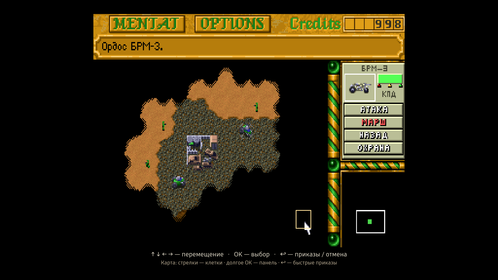
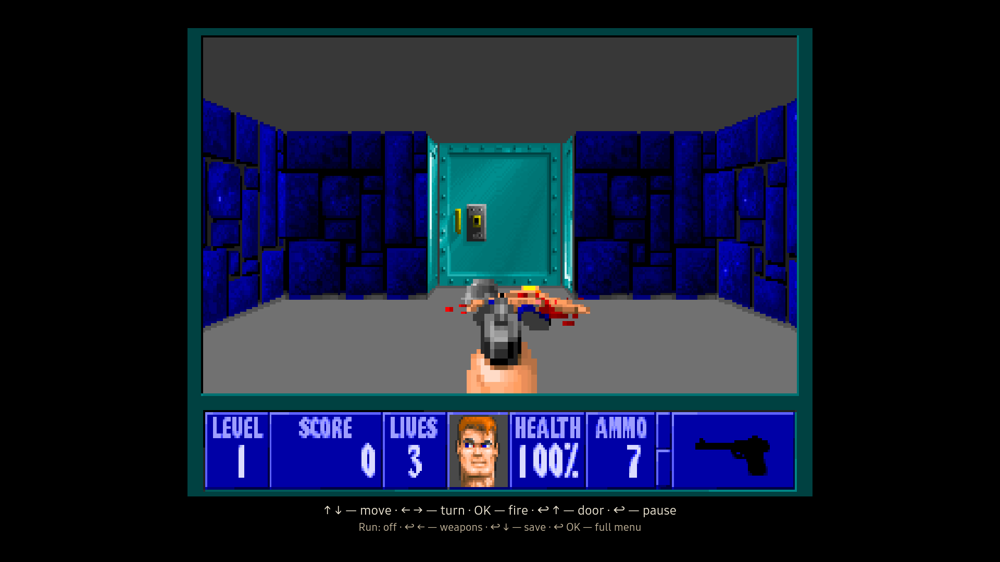
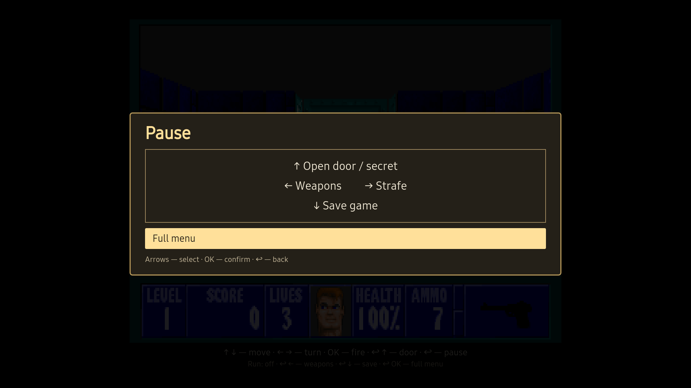
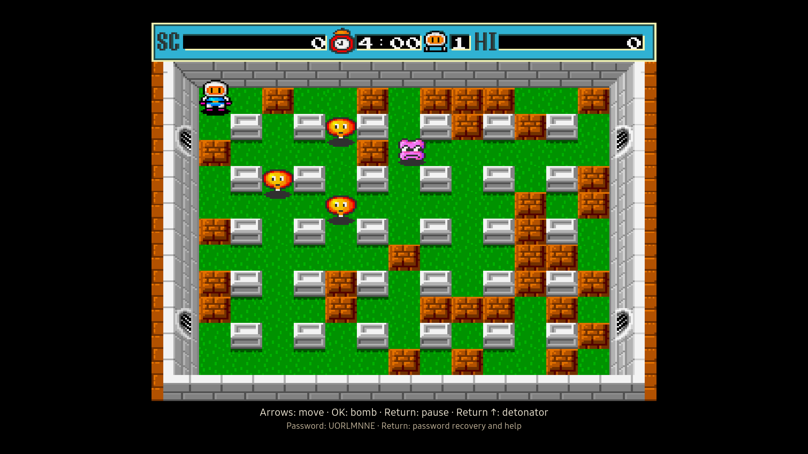
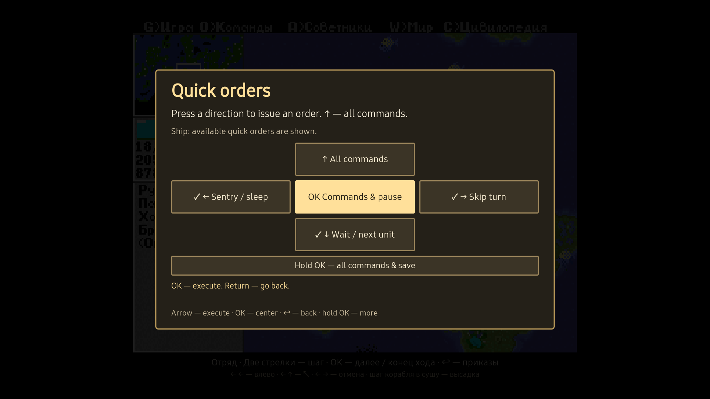

# Samsung TV Game Ports

[](https://github.com/Atreides07/port-samsung-tv-games/actions/workflows/validate.yml)
[](LICENSE)

An Agent Skill focused on porting classic DOS games to Samsung Smart TV / Tizen
with controls people can actually use from the sofa.

It guides an AI coding agent through running original DOS games in local runtimes:
remote input, contextual commands, original audio, reliable saves, performance
profiling and optimization by default, and verification of the final TV package. It also supports native
HTML/Canvas adaptations.

**[Install for Codex, Claude, or Cursor](docs/installation.md)** ·
**[Download skill ZIP](https://github.com/Atreides07/port-samsung-tv-games/releases/latest/download/port-samsung-tv-games.zip)** ·
**[Read the skill](SKILL.md)** · **[Port examples](docs/examples.md)**

## Games behind the workflow

All nine images below come from games running on a **physical Samsung
UE65TU8570UXRU TV, Tizen 5.5 / Chromium 69**, captured between 2026-10-28 and 2026-10-30.
They retain the actual game and remote-control interface shown by the TV;
English captions describe the original English and Russian interfaces.
The Wolfenstein and Dyna Blaster wrappers and the Civilization ship-order panel are shown in English
for these captures; their original game graphics are unchanged.
See the [capture notes](docs/examples.md#included-captures) for the render-layer
capture method, isolated game sessions, and verification limits.

| X-COM: UFO Defense | Dune II |
| --- | --- |
|  |  |
| Original DOS game with tactical movement and contextual actions. | Original DOS mission during a unit movement order. |
| **Prince of Persia** | **Zuma Deluxe** |
|  |  |
| Original DOS platformer with a running-jump input adapter. | HTML/Canvas adaptation using original resources; it does not execute the Windows game. |

| Wolfenstein 3D — gameplay | Wolfenstein 3D — quick commands |
| --- | --- |
|  |  |
| Immediate fire and direct movement in the original DOS game. | Return opens the panel; a direction selects a command. A door takes two presses, weapon selection three. |

The English interface is a separate capture copy of the Russian TV wrapper.
The original executable, six episodes, rendering and game rules are preserved.

**Dyna Blaster — original DOS gameplay**



Arrows move, OK places a bomb immediately, and Return pauses the original game.
The detonator takes Return, Up after its power-up is collected. Original
eight-letter passwords restore a level after restarting the app; they do not
restore the exact position. This English capture uses an isolated wrapper and a
checkpoint accepted by the original game.

**Sid Meier's Civilization — gameplay**


Original DOS gameplay with the world map, active unit, and native Russian interface.

**Sid Meier's Civilization — contextual ship orders**



Object-specific quick actions and persistent sentry duty, shown in English for
this TV capture. Return opens the panel; a direction selects an order.
The original DOS game remains in Russian.

See [examples and capture provenance](docs/examples.md) for the demonstrated
behaviors and the limits of what these screenshots prove. Game archives,
executables, runtime bundles, and installable TV games are not distributed here.

## What the skill covers

- **Controls first:** arrows, OK, and Return; held keys, focus, useful shortcuts,
  action timing, and contextual command availability.
- **Feasibility before integration:** target TV/runtime compatibility and an early
  test of the game's hardest relevant interaction.
- **Offline operation:** local assets, original audio where available, and final
  package checks with the network unavailable.
- **Durable progress:** complete save transactions, lifecycle recovery, previous
  version updates, and careful save migration.
- **Optimization by default:** profile and fix measured gameplay bottlenecks as
  part of the port; no separate optimization request is needed. Check game speed,
  input, original audio, image quality, resources, and the final TV package together.
- **Honest verification:** browser results, physical-TV traces, speaker listening,
  and manual-remote play are reported separately.

A complete-port request includes controls and performance work. A request for a
plan, audit, or narrow fix keeps that scope. The skill does not authorize changing
other games, network/VPN settings, or publishing third-party game assets.

## Install and use

The repository root is the skill directory. Choose **one** installation location
per agent; the full [installation guide](docs/installation.md) includes personal
and project paths, Windows commands, updates, and Claude ZIP upload.

| Tool | Personal installation | Invoke |
| --- | --- | --- |
| Codex | `~/.agents/skills/port-samsung-tv-games/` | `$port-samsung-tv-games` |
| Claude Code | `~/.claude/skills/port-samsung-tv-games/` | `/port-samsung-tv-games` |
| Cursor | `~/.cursor/skills/port-samsung-tv-games/` | Select `/port-samsung-tv-games` in Agent chat |
| Claude web/Desktop skills | Upload the packaged skill ZIP in Customize → Skills | Ask to use the Samsung TV game-porting skill |

Example request:

```text
Use $port-samsung-tv-games to port this game to my Samsung Tizen TV.
Keep the original rules and audio, make the core loop usable with arrows,
OK, and Return, and verify saves and performance. Report browser checks
separately from physical-TV checks.
```

For a focused correction:

```text
Use the Samsung TV Game Ports skill to fix running jumps on this remote.
Keep the existing game rules, application IDs, saves, audio, and rendering.
Verify the actual jump and affected input regressions.
```

An agent needs access to the game project and appropriate build/test tools.
Actual installation requires the user's authorized TV access and signing setup.
A cloud chat can review or prepare files, but it needs an explicitly connected
execution environment to inspect your local project or operate your TV.

## Structure

```text
SKILL.md                              Shared workflow and acceptance criteria
agents/openai.yaml                    Codex UI metadata; optional for other agents
references/action-controls.md         Timing-sensitive controls
references/contextual-commands.md     Strategy and object-specific orders
references/compatibility-and-lifecycle.md
references/porting-notes.md           Historical DOS and rendering case studies
docs/installation.md                 Agent-specific installation instructions
docs/examples.md                     Examples and screenshot provenance
scripts/validate.py                   Metadata, links, and package hygiene checks
scripts/package.py                    Minimal portable skill ZIP builder
```

## Validate and package

Python 3.10+ and PyYAML are needed only for the repository checks and packaging;
using the instruction files does not require a Python dependency.

```sh
python3 -m pip install -r requirements-dev.txt
python3 scripts/validate.py
python3 -m unittest discover -s tests -v
python3 scripts/package.py
```

The ZIP is written to `dist/port-samsung-tv-games.zip`. It contains one
`port-samsung-tv-games/` folder with the instructions, references, UI metadata,
and license; it excludes screenshots, development files, and game content.
GitHub Actions runs the same checks and publishes the ZIP as a workflow artifact.

## Contributing

Keep the core skill focused and move substantial conditional guidance into a
reference linked from SKILL.md. Explain the real porting failure or scenario
behind a change, add a meaningful check for changed helper logic, and run the
validation commands above. Do not commit game archives, signing keys, credentials,
private device details, or claims of hardware testing without evidence.

Historical case studies are observations from particular ports, not universal
DOS presets or promises that every Samsung model will behave the same way.

## License and game credits

Original skill instructions and helper code are [MIT licensed](LICENSE).
The screenshots illustrate third-party games and are excluded from that license;
no rights to their artwork, trademarks, or game assets are granted.

Examples credit the original games and creators/publishers: X-COM: UFO Defense
(MicroProse), Sid Meier's Civilization (MicroProse), Dune II (Westwood Studios),
Prince of Persia (Jordan Mechner /
Brøderbund), Zuma Deluxe (PopCap Games), Wolfenstein 3D (id Software /
Apogee Software), and Dyna Blaster (Hudson Soft). Their names identify the examples;
this project is independent of Samsung and those game creators.
